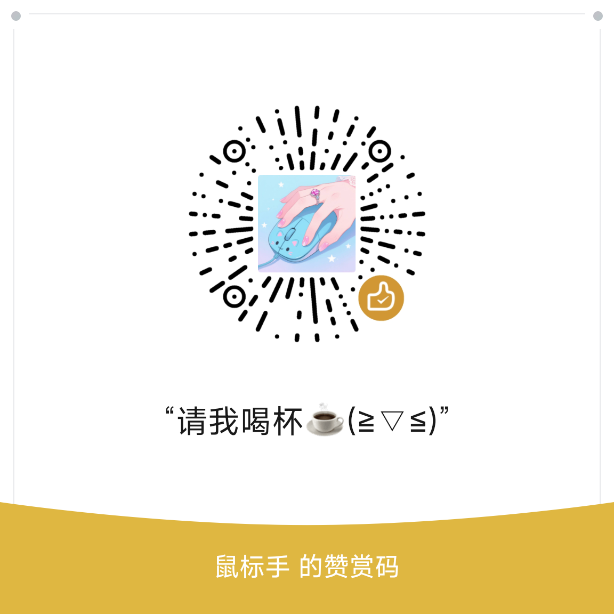
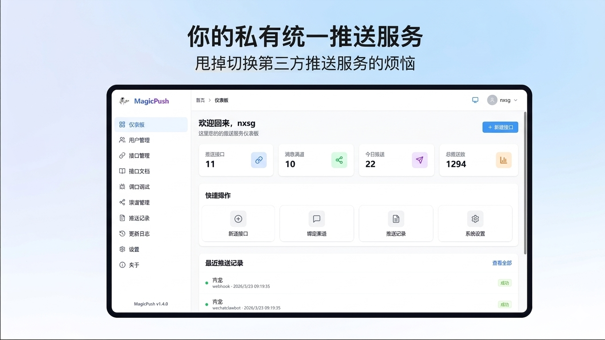
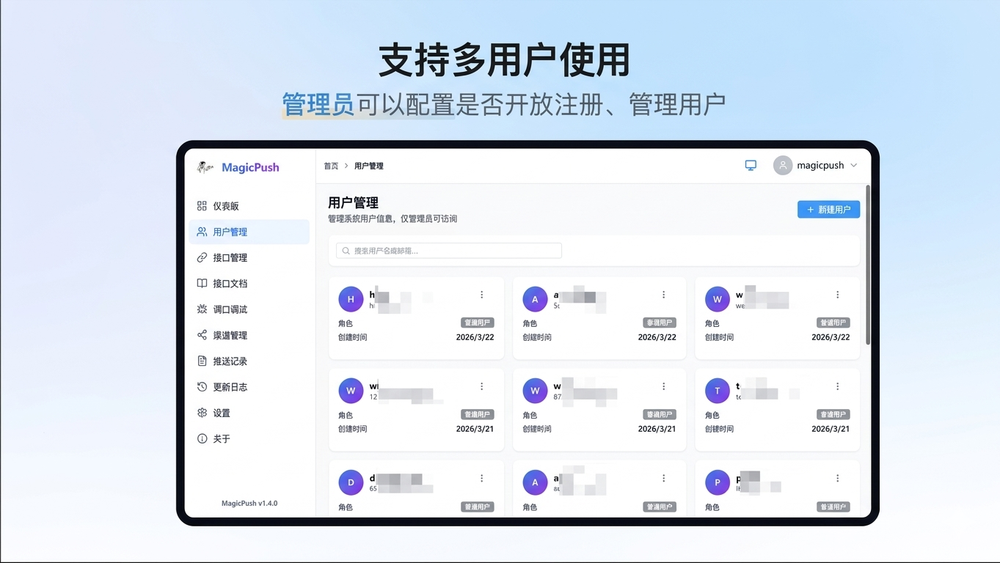
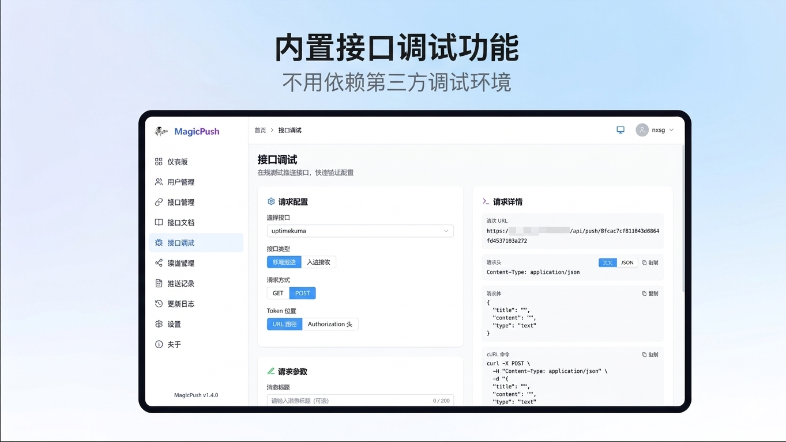
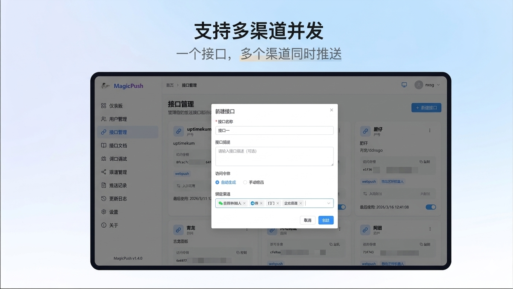
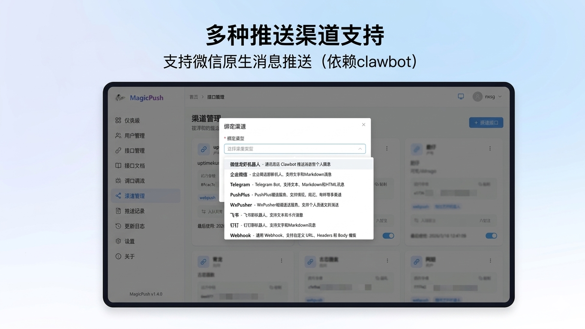
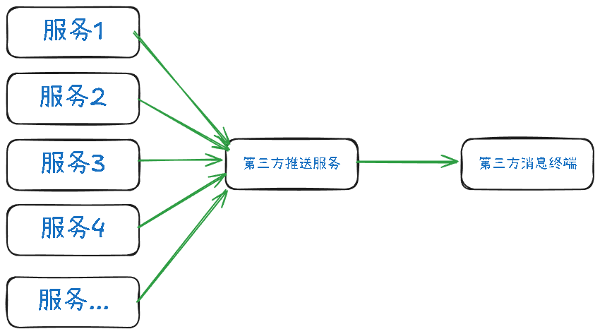
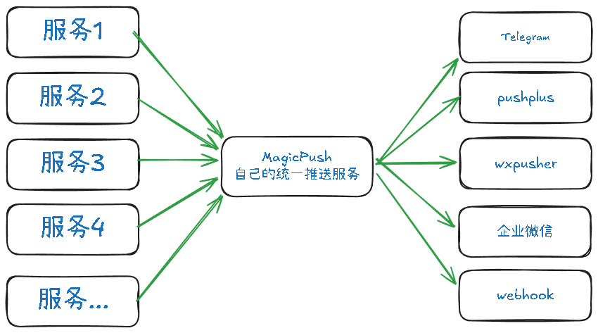

  
  <h1 align="center">魔法推送</h1> 
  
    <a href="https://www.160621.xyz/magicpush" target="_blank">官方网站</a> |
    <a href="https://www.160621.xyz/magicpush/guide/dev/overview.html" target="_blank">开发文档</a> |
    <a href="https://github.com/magiccode1412/magicpush" target="_blank">项目地址</a> |
    <a href="docs/CHANGELOG.md">更新日志</a>
  
  
一个支持多种消息渠道的推送服务管理平台，用户可以通过标准化的REST API接口将消息推送到多种通知渠道。

  

    
    
    
    
  

## 打赏

<table>
  <tr>
    <td align="center">
      支付宝
       
      
    </td>
    <td align="center">
      微信
       
      
    </td>
  </tr>
</table>

## 🌐 Demo站

由于没有好的沙箱环境用于部署Demo，且Docker部署门槛不高，故不再提供Demo预览

## 预览

  
点击查看预览图

  

    
    
    
    
    
    <!-- 
    
    
    
    
    
    
    
    
     -->
  

## 困境

市面上有很多消息推送服务,但是各个各的局限,例如:
  + Telegram ➡️ 最优秀的消息推送服务,但是需要魔法
  + 企业微信/钉钉/飞书 ➡️ 消息仅限于企业内部
  + 微信服务号 ➡️ 模板消息限制太多
  + 微信龙虾机器人 ➡️ 支持直接推送到个人微信，但有10条/24小时限制

也有一些开发者,开始转向App推送,更甚者,开始支持手机系统底层推送,例如:
+ pushplus: 支持多渠道推送,包括微信服务号/App/webhook
+ wxpusher: 支持多种手机的系统级推送,不需要App运行

其实市面上的推送服务基本都覆盖到了(**除了万恶之首的微信**),但是我们必须考虑如果作为中转的第三方推送服务宕机了,或者说不玩了,会有什么后端,得更新所有的调用代码/令牌

通过以下几张图,就会明白,自己拥有一个推送服务,是多么的有用:
+ 一对一的消息推送方式

+ 多对一推送服务

+ 使用自己的推送服务

## ✨ 功能特性

### 消息渠道支持

| 分类 | 渠道 |
|------|------|
| **微信生态** | 微信龙虾机器人、元宝 Bot、企业微信机器人、企业微信应用、微信公众号、Server酱、息知 |
| **即时通讯** | Telegram Bot、飞书机器人、钉钉机器人、QQ机器人 |
| **App推送** | PushPlus、WxPusher、Bark、Meow、PushMe、ntfy、PushDeer、iGot |
| **通用协议** | Webhook、SMTP邮件、Gotify、MQTT |
| **其他** | 群晖 Chat、ShowDoc、小爱音箱 |

> 📖 各渠道详细配置说明及频率限制请查看：[推送渠道配置文档](https://www.160621.xyz/magicpush/guide/channels/rate-limits.html)

### 核心功能
- 多渠道消息同时推送
- 标准化REST API
- 双令牌JWT认证机制 (access/refresh token)
- 用户注册/登录
- 渠道绑定与配置管理
- 推送接口管理（多接口/多令牌）
- **推送消息关键词过滤**（支持黑名单/白名单模式，按接口独立配置）
- **消息免打扰（DND）**（支持按接口配置多个免打扰时段，全局开关控制）
- 推送历史记录与状态追踪（含接口名称标识）
- 响应式Web管理界面
- 深浅色主题切换

### 安全防护
- **三层限流防护**
  - Nginx 层：IP 级请求频率限制 + 并发连接控制（兜底保护）
  - Express 全局：按 IP 限制每分钟总请求数
  - Express 接口级：针对登录、注册、推送、入站等接口独立限流
- **全局限流开关**：管理员可在前端「安全设置」页面一键启用/禁用所有限流规则（默认开启）
- **动态限流配置**：管理员可在前端「安全设置」页面实时调整所有限流额度，修改立即生效，无需重启服务
- **推送接口双重限流**：同时按来源 IP 和推送 Token 限流，防止 Token 泄露后被滥用
- 限流触发时自动记录日志，方便排查异常请求

> **注意：** 预构建的 Docker 镜像（`magiccode1412/magicpush:latest`）为 All-in-One 模式（Express 直接提供静态文件），不包含 Nginx，因此仅具备 Express 层的两层限流。如需启用 Nginx 层的兜底限流，请使用 `docker-compose up -d` 自行构建前后端分离镜像。

> **部署要求：** 生产环境必须将后端部署在**反向代理（Nginx / 宝塔 / 雷池 / Lucky 等）之后**，且后端端口不对公网直连（网络隔离是防止 IP 伪造的真正边界）。真实客户端 IP 由 `TRUST_PROXY` 环境变量控制（默认信任单反代），多跳或接入 CDN 的场景请参考 [Docker 部署 - 反向代理部署](https://www.160621.xyz/magicpush/guide/deploy/docker.html)。

## 🛠️ 技术栈

### 后端
- Node.js 18+
- Express.js 4.x
- SQLite3 (better-sqlite3)
- JWT (jsonwebtoken)
- bcryptjs (密码加密)
- express-rate-limit (API 限流)

### 前端
- Vue 3 (Composition API)
- Vite 5.x
- Tailwind CSS 3.x
- Element Plus
- Pinia (状态管理)
- Vue Router 4.x

## 💖 感谢墙

<table align="center">
  <tr>
    <td align="center">
      <a href="https://github.com/Sunanang">
        
         Lando
      </a>
    </td>
    <td align="center">
      <a href="https://github.com/tt-haogege">
        
         tt-haogege
      </a>
    </td>
    <td align="center">
      <a href="https://github.com/HuFakai">
        
         HuFakai
      </a>
    </td>
  </tr>
</table>

## 📄 许可证

MIT License
